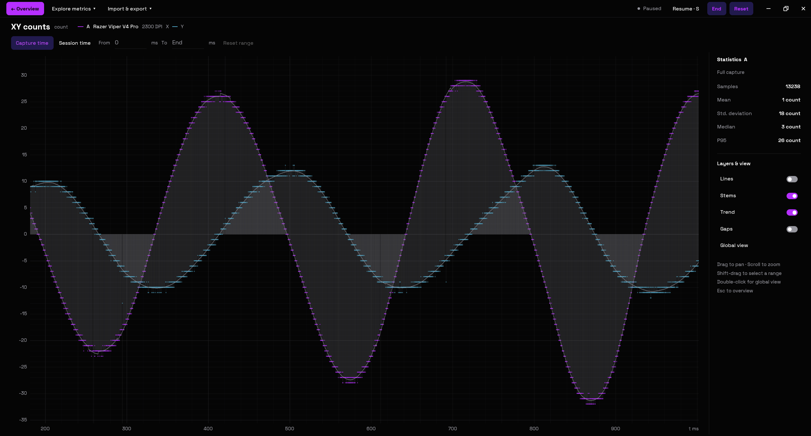
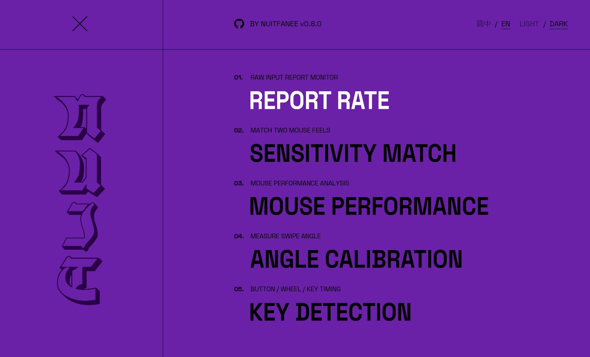
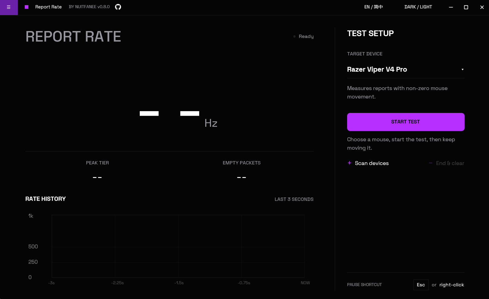
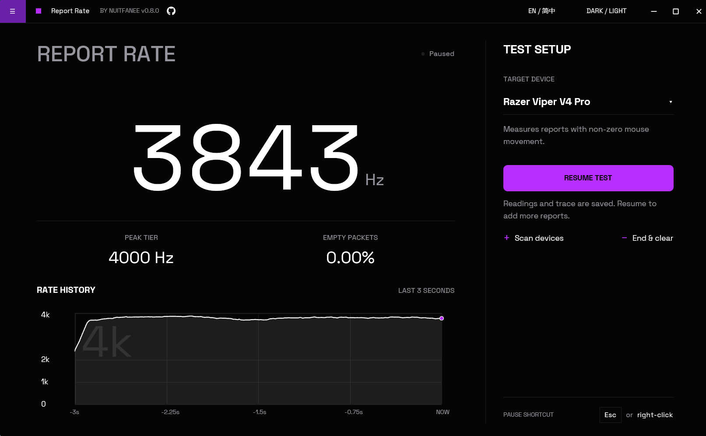
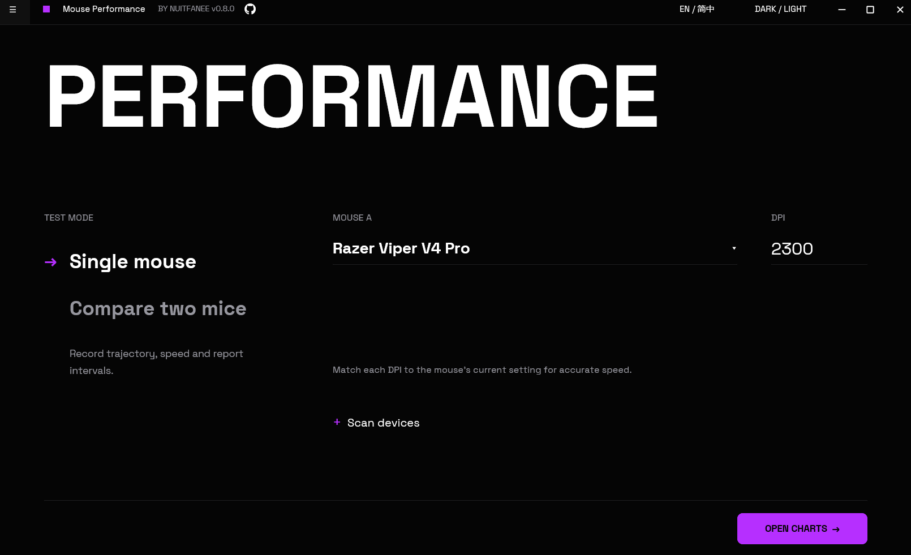
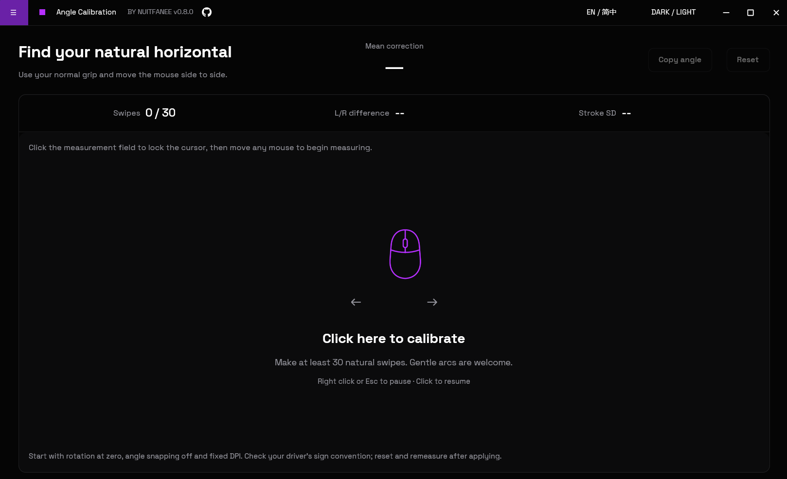
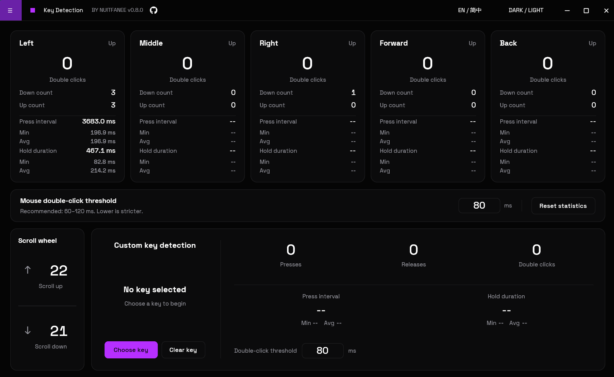

<h1 align="center">ClickSync Mouse Tester</h1>

<p align="center"><a href="README.md">English</a> · <strong>简体中文</strong></p>

<p align="center">
  <strong>以交互图表解析鼠标轨迹、位移、速度与报告时序。</strong><br>
  支持双鼠标及历史数据对比，集成回报率测试、灵敏度匹配、角度校准，以及鼠标按键、滚轮与自定义键检测。
</p>

<p align="center">
  
  
  <a href="LICENSE"></a>
</p>

<p align="center">
  <a href="https://github.com/Nuitfanee/ClickSyncMouseTester/releases">下载</a> ·
  <a href="#功能">功能</a> ·
  <a href="#如何使用">如何使用</a>
</p>

受到 [MouseTester](https://github.com/microe1/MouseTester) 启发的 Windows 鼠标测试与分析工具。
**自 v0.8.0 起，已完成 Rust 重写**，使用 GPUI 构建界面、Direct3D 11 绘制图表，通过 Windows Raw Input 采集输入。



## 功能

| 功能 | 能做什么 |
| --- | --- |
| **鼠标性能图表** | 记录轨迹、X/Y 位移、速度、报告间隔与频率；支持单鼠标采集、双鼠标对比、图表平移缩放与选定时间范围统计 |
| **记录对比** | 以 JSON 导入、导出完整记录，叠加历史数据进行对比 |
| **回报率测试** | 查看实时运动报告率、峰值档位、空包率和最近 3 秒曲线 |
| **灵敏度匹配** | 同步移动两只鼠标，计算目标鼠标的推荐 DPI，匹配原鼠标的平移灵敏度 |
| **角度校准** | 分析自然横扫，给出平均补偿角、左右差和笔间波动，支持复制结果 |
| **按键、滚轮与自定义键检测** | 查看五个鼠标按键的按下/抬起计数、双击、按压间隔和持续时间；支持滚轮及自定义键检测 |
| **界面** | 支持英文、简体中文，以及深色、浅色主题 |

## 界面预览

<details open>
<summary>展开查看导航、回报率、性能配置、角度校准与按键检测</summary>

**导航**



**回报率：准备与测试结果**




**性能测试配置**



**角度校准**



**按键检测**



</details>

## 如何使用

### 启动

支持 **Windows x64**。获取 **v0.8.0 或更高版本**的 `.exe` 发布包后，双击即可运行；发布包见 [Releases](https://github.com/Nuitfanee/ClickSyncMouseTester/releases)，也可从源码启动。
进入功能页后，可通过左上角菜单切换功能，右上角切换语言与主题。

<details>
<summary>从源码运行</summary>

安装 rustup、Visual Studio Build Tools 的 C++ 工具链及 Windows SDK，在仓库根目录执行：

```pwsh
cargo run --release -p clicksync-app --bin clicksync-app --locked
```

Rust 版本由 `rust-toolchain.toml` 固定。

</details>

### 鼠标性能图表

1. 选择单鼠标或双鼠标模式，选择设备，填写各鼠标当前实际 DPI，打开图表。
2. 点击空轨迹画布或按 `S` 开始记录；按 `S` 暂停/继续，通过工具栏结束或重置。
3. 拖动平移、滚轮缩放；在指标菜单查看详情与范围统计，通过“数据导入与导出”保存完整 JSON 或添加对比数据。

### 回报率测试

选择鼠标，点击开始测试，持续移动鼠标并观察读数与曲线。
按 `Esc` 或右键暂停，点击继续追加测量；点击“结束并清空”重置测试。该页面测量非零位移的运动报告率。

### 灵敏度匹配

1. 分别点击绑定并移动对应鼠标，绑定**被复制鼠标**和**目标鼠标**，填写目标鼠标当前 DPI。
2. 进入测量，按 `S` 或点击开始，等待准备提示结束；将两只鼠标并排贴稳、朝向一致，一起向右移动约 **10 cm**。
3. 测量自动结束后，将推荐 DPI 应用到目标鼠标。移动时避免两只鼠标相互滑动或整体转动。

### 角度校准

将驱动旋转角设为零、关闭角度修正并固定 DPI。点击测量区域，使用日常握姿自然左右横扫，完成至少 **30 次有效笔画**。
查看平均补偿角、左右差和笔间波动；按 `Esc` 或右键暂停，点击继续。复制角度后按驱动的正负方向设置，重置并复测。

### 按键、滚轮与自定义键检测

保持窗口前台，点击鼠标按键或滚动滚轮即可查看统计。
点击“选择按键”后按下要检测的键；可分别调整鼠标与自定义键的双击阈值，点击“清空统计”重新计数。

## 开源协议

本项目采用 [MIT License](LICENSE)。第三方依赖及字体遵循各自的许可证。
